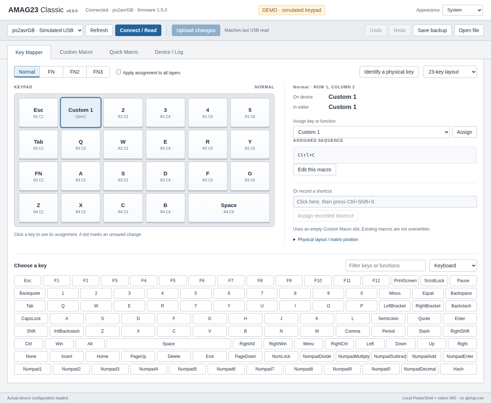

# AMAG23 Classic

**An easy-to-use, local configuration app for the Koolertron 23-key programmable macro keypad.** See which keys and macros are assigned, change them visually, and save the changes to the keypad without running Koolertron's configuration program.


*Is this your keypad? This is the [Koolertron AE-AMAG23](https://www.koolertron.com/koolertron-one-handed-macro-mechanical-keyboard-with-23-fully-programmable-keys.html). Photo: Koolertron (linked from the manufacturer's website).*

## Why use it?

Installing Koolertron's original software may be impossible e.g. on computers managed by employers or educational institutions. **AMAG23 Classic is an alternative when PowerShell 7 is already available and permitted to run.** You can simply unpack the project and launch its graphical interface. There is no separate installer, `gbmgr.exe` requirement, firmware replacement, or cloud service.

You get a familiar window with your keypad's **actual assignments**, rather than a blank design template. It supports:

- **Visual key mapping:** see all 23 keys and switch between the **Normal**, **FN**, **FN2**, and **FN3** layers.
- **Custom and quick macros:** view, edit, record, copy, and assign shortcut sequences, including delays where supported.
- **Read and upload:** load the current keypad configuration, review changes, and write them back with a backup and read-back verification.
- **Profiles and backups:** save the configuration and import compatible AMAG configuration files.
- **Appearance:** select **System**, **Light**, or **Dark**. System follows the OS theme, including changes while the app is open; the choice is remembered for future launches.



*Example interface using simulated assignments. [See dark mode](docs/app-dark.png).*

## Get started

**What you need:** Windows 11 or a recent Linux distribution, [PowerShell 7.4+](https://learn.microsoft.com/en-us/powershell/scripting/install/install-powershell-on-windows) (7.6 LTS recommended), a modern browser such as Edge, Chrome, or Chromium, and the connected keypad. PowerShell 7 uses the command `pwsh`, not the older `powershell.exe`.

1. From the **Releases** section of this GitHub repository, download the attached `AMAG23-Classic-v*.zip` file. (If you are reading the source repository rather than a release, you can also download its source ZIP.)
2. **Extract the ZIP** somewhere you can access. Do not run the files inside the compressed folder.
3. **Windows:** double-click `Launch-on-Windows.cmd`. **Linux:** open a terminal in the extracted folder and run `pwsh -NoProfile -File ./Start-AMAG23.ps1` (or `./launch-on-linux.sh` if it is executable).
4. The interface opens in a local app-style browser window. Leave the PowerShell window open while you use it.
5. Select your `ps2avrGB` keypad and click **Connect / Read**.
6. Click a key in the picture to see **On device** and **In editor**. Choose a new assignment, or click **Edit this macro** to change its sequence.
7. Click **Upload changes**, review the changes, and confirm. The app saves a backup and reads the configuration back to check it.

**Example:** To set one key to `Ctrl+C`, select the key, click the shortcut field, press the shortcut, and choose **Assign recorded shortcut**. Then use **Upload changes** to save it to the keypad.

**Windows: script blocked after download?** Windows may mark downloaded scripts as coming from the internet and refuse to run them. If this happens, open PowerShell in the extracted folder and run:

```powershell
Unblock-File -Path .\Start-AMAG23.ps1
```

Only do this after checking that you trust the downloaded file. This removes the internet-download marker; it does **not** override security restrictions imposed by your organization. See [Microsoft's `Unblock-File` documentation](https://learn.microsoft.com/en-us/powershell/module/microsoft.powershell.utility/unblock-file).

> **On restricted computers:** The app does not require *installing this project*, but it still needs permission to run PowerShell scripts, compile its bundled C# code in memory via `Add-Type`, and access the keypad over USB. Some organizations block these operations. This project does not bypass administrative or security policies. If `pwsh` is unavailable or execution is prohibited, ask your administrator for an approved approach.

## Before uploading

The app does **not** replace the keypad's firmware with QMK, VIA, or anything else. Its original firmware stores some settings in flash memory; writing keymaps and custom macros therefore uses the keypad's *existing* bootloader. Quick macros are stored in EEPROM.

**An interrupted upload can still corrupt configuration data.** Keep the keypad connected during the upload, do not close PowerShell, and retain your backups. Configuration backups are **not** complete firmware backups. As with any community-built USB tool, behavior can vary across firmware revisions and operating systems.

Automatic backups are saved in your user profile (the **Device / Log** tab shows the exact location). They may contain sensitive typed sequences, including passwords, so treat them as private files.

## Appearance and privacy

Use the **Appearance** menu in the top-right corner:

- **System** (default) follows your OS's light/dark appearance automatically.
- **Light** or **Dark** overrides the OS. Your selection is stored in `preferences.json` in the app's user-data folder and survives restarts.

The app runs entirely on your computer. Its browser interface talks only to a local PowerShell server at `127.0.0.1`; it does not transmit your macros to the internet. No telemetry, third-party scripts, account, or online connection is needed to use it.

## Which keypads are supported?

This project targets **Koolertron AE-AMAG23 devices using the `ps2avrGB` firmware**, identified by USB vendor/product ID **`20A0:422D`**. A matching ID alone does not guarantee compatibility with every manufacturing revision. It is **not** a general-purpose keyboard editor.

For Linux, access to `/dev/hidraw*` may require a device-specific udev rule and administrator assistance. See [`linux/70-amag23.rules`](linux/70-amag23.rules) for a rule you can review before installing. On Windows, close any other keyboard configuration software before using this app.

## Problems?

**The app does not start:** Make sure PowerShell 7.4 or later is installed or otherwise made available through an approved channel. Run `pwsh --version` to check. If the PowerShell window shows an error, keep that message when reporting the issue.

**The keypad is not listed:** Plug it directly into USB, close other configuration utilities, and click **Refresh**. On Linux, check `hidraw` permissions.

**An upload fails:** Do not immediately retry. Read the message in **Device / Log**, keep the automatic backup, and reconnect/read the keypad before another attempt. A failed verification does not mean the configuration was saved correctly.

Report problems on GitHub, but **never attach an unreviewed backup**, which may expose confidential macros. Include the operating system, `pwsh --version`, keypad USB ID, and the exact error message instead.

## Credits, license, and development

This is an **independent, unofficial project**, not software published or endorsed by Koolertron.

Created by **Alek Rutkowski** ([alek.rutkowski@gmail.com](mailto:alek.rutkowski@gmail.com)). Licensed under the [MIT License](LICENSE).

The protocol research and implementation benefit from the prior work of **showjean** on [ps2avrU / ps2avrGB firmware](https://github.com/showjean/ps2avrU) and [Bootmapper](https://github.com/showjean/Bootmapper), **Koolertron**'s hardware and documentation, and the [QMK AMAG23 board definition](https://github.com/qmk/qmk_firmware/tree/master/keyboards/amag23). The user-supplied original utility was studied to understand communication details, **not bundled or executed**. All direct and indirect references, system APIs, image attribution, and test dependencies are listed in [ACKNOWLEDGMENTS.md](ACKNOWLEDGMENTS.md).

For technical details, see [PROTOCOL.md](PROTOCOL.md). For tests and contribution guidance, see [CONTRIBUTING.md](CONTRIBUTING.md).
